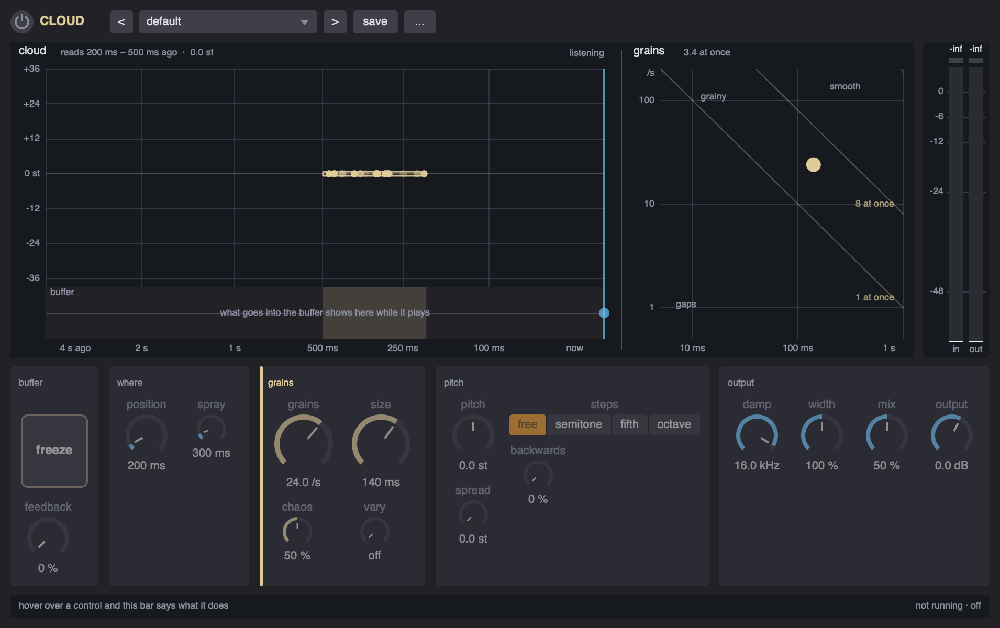

# Cloud

**A live granulator - what you play turns into a cloud of itself, and freeze keeps it there - running anywhere a UGen does, with a window.** A SuperCollider extension.



```supercollider
s.boot;
Ndef(\gtr, { Cloud.ar(Pluck.ar(WhiteNoise.ar(0.2 ! 2), Impulse.kr(1), 0.02, 0.005, 2), \cloud) }).play;

c = Cloud(Ndef(\gtr), \cloud);
c.gui;
c.grains = 40; c.grainSize = 0.12;
c.pitchScatter = 7; c.quantize = \fifth;
c.freezeOn = true;                  // stop listening, keep reading
c.preset = 'shimmer haze';
```

Every effect of this family lives in the same three places. Write `Cloud.ar` into a graph of your own and drive it from the object, as above; give it a node of its own on a bus, `Cloud.onBus(0, 2).enabled_(true)`; or put it in a chain, `FxChain.master.add(Cloud())`. If SuperDirtGUI is installed, it is an insert on an orbit too: `~sdg.addInsert(0, \cloud)`.

It is built on [FxKit](../sc%20fx%20kit), which is built on [ParaEQ](../sc%20EQ), and the class library will not compile without them; the installer links both when the folders sit side by side. It uses SuperCollider's own UGens, not sc3-plugins.

Written for SuperCollider 3.13 on macOS. Nothing in it is platform specific apart from the symlink in `install.scd`, which Linux shares and Windows does not.

## Install

### As a quark

```supercollider
Quarks.install("https://github.com/fracnesco/sc-cloud.git");
thisProcess.recompile;
```

The manifest names `sc-fx-kit` as a dependency, which names `sc-eq`, so `Quarks` fetches those first. The quark goes by the name of the repository, `sc-cloud`; the class inside it is `Cloud`.

### From a clone

Clone `sc-eq` into a folder called `sc EQ`, `sc-fx-kit` into `sc fx kit` and this into `sc cloud`, side by side. Open `install.scd` and evaluate its first block, then recompile the class library. It links what is missing and tells you what it did.

On Windows there is no `ln -s`, so use the quark, or copy the three folders into the extensions folder by hand: `Platform.userExtensionDir.openOS` opens it.

Install it one way or the other, **not both**: two copies on the class path is a duplicate class error at compile time.

### Check that it took

```supercollider
Cloud.presetNames;
Cloud.onBus(0, 2).enabled_(true).gui;
```

Select `Cloud` and press cmd/ctrl + d for the help file, and see [examples/cloud-demo.scd](examples/cloud-demo.scd) for a walkthrough you can evaluate a block at a time.

## What it does

The input goes into 4 seconds of buffer per channel, and grains of it are read back: from `position` seconds ago, give or take `scatter`, at a `pitch`, give or take `pitchScatter`, optionally held to a scale by `quantize`. `backwards` says how many play backwards. `chaos` goes from grains like clockwork, which gives the cloud a pitch of its own, to grains at random.

`feedback` puts the cloud back in the buffer, so it can grow out of itself. `freezeOn` stops writing, and what is in there goes on being read for as long as you like.

Each channel has its own buffer and its own grains, so a stereo cloud is wide. A forward grain faster than the write head starts far enough back never to catch it up, which is the one thing that would otherwise click. There can be 256 grains at once on a channel: `grains` gives way if the grains are too long for that.

Each instance takes about 1.5 MB of the server's real time memory at stereo, more for its grains. A stock server has 8 MB and does not fit it at 12 channels (`alloc failed` in the post window, and no sound), so several of them, or a wide bus, call for `s.options.memSize = 8192 * 32` before booting.

## The window

`c.gui` opens it (`c.panel(view)` puts the same thing in a view of yours): the top row (on, presets, save, the menu with copy and paste), the display with the in and out meters beside it, and one row of cards. Hover over anything and the bar at the bottom says what it does.

The display has two panes. **cloud** is the buffer: time runs from now, on the right, back to 4 seconds ago on the left (the last second gets most of the room), pitch goes up in semitones.

- **the box** is where grains may fall: from `position` back to `position` + `scatter` (spray), at `pitch` give or take `pitchScatter` (spread). With `quantize` on, the steps the grains are held to are lines across it, numbered while there is room.
- **the dots** are grains, drawn from the same numbers as the server's: each with a streak from where it started to where it reads now, since a grain moves through the buffer at its own speed while the write head moves at one (an octave up starts further back and catches up; a backwards one drifts away). Hollow ones play backwards. A grain reading silence is dim.
- **buffer**, along the bottom, is what went in while the window was open - the input and the feedback - with the part the grains read shaded. The write head is the line at now, blue while it listens; frozen, it stops and turns orange, and the strip stands still with it.
- a dashed line carries `feedback` from the box back to the write head.

**grains** is a map of grain size (along) against grains a second (up), both on log scales. The dot is the setting; its bar, while `sizeScatter` is up, how far the size may stray. The diagonals say how many grains sound at once: under 1 there are gaps, past 8 it turns smooth. In the shaded corner the server holds the rate down, to keep under 180 grains at once of the 256 a channel can play, and the caption says to what.

It says what the cloud is doing; it does not report each grain the server makes.

| in the display | does |
|---|---|
| drag the box | along: `position`, up and down: `pitch` |
| drag its left edge | the spray (`scatter`) |
| drag its top or bottom edge | the spread (`pitchScatter`) |
| the wheel | the spray; with alt, or on the top or bottom edge, the spread |
| drag the buffer strip | `position` |
| drag the dot in the grains map | along: `grainSize`, up: `grains` |
| the wheel there | `sizeScatter` (vary) |
| shift | fine, a tenth as far |
| double click | back to the default of what is under it |

Hovering a part of the display lights the knobs that set it, and hovering a knob lights its part.

The cards, left to right: *buffer* - the `freeze` pad (click it to latch, hold it for a moment's freeze) and feedback, dimmed while frozen since the buffer is not written then; *where* - position and spray; *grains*, in the cloud's sand colour - grains a second and size, the two big knobs, with chaos and vary; *pitch* - pitch, spread, the steps (free / semitone / fifth / octave) and backwards; *output* - damp, width, mix and output.

## Presets

Built in: default, fine mist, shimmer haze, stone rain, backwards, frozen pad, fifths tower, clockwork, octave down.

Yours go in `Platform.userAppSupportDir/cloud-presets.scd`: `c.saveAsPreset("mine")`, or press save in the window and give it a name. `c.copySettings` and `other.pasteSettings` carry settings from one to another.

## Parameters

Every parameter is a property: `c.grains`, `c.grains = ...`. These also work by name, `c.set(\grains, ...)`, `c.get(\grains)`. Knobs clip to their range. This table is generated from the class.

| parameter | section | range | default | what it does |
|---|---|---|---|---|
| `grains` | grains | 0.5 .. 200 /s | 24 | how many grains a second start - or drag the dot in the display's grains map up and down |
| `grainSize` | grains | 0.005 .. 1 s | 0.14 | how long a grain lasts - or drag the dot in the grains map along |
| `sizeScatter` | grains | 0 .. 3 oct | 0 | how far a grain's length may stray, in octaves either way - or the wheel on the grains map |
| `chaos` | grains | 0 .. 1 | 0.5 | 0 starts the grains like clockwork, which gives the cloud a pitch of its own; 1 at random |
| `position` | where | 0 .. 3.5 s | 0.2 | how long ago the grains are read from - or drag the box in the display along |
| `scatter` | where | 0 .. 3.5 s | 0.3 | how much further back a grain may start - or drag the box's left edge, or the wheel in the display |
| `freezeOn` | buffer | on / off | false | stop listening: the buffer holds what is in it and the grains go on reading it - hold the pad for a moment's freeze |
| `pitch` | pitch | -24 .. 24 st | 0 | every grain, in semitones - or drag the box in the display up and down |
| `pitchScatter` | pitch | 0 .. 24 st | 0 | how far a grain's pitch may stray either way - or drag the box's top or bottom edge |
| `quantize` | pitch | free semitone fifth octave | free | hold each grain's pitch (and the pitch itself) to steps of a semitone, a fifth or an octave |
| `backwards` | pitch | 0 .. 1 | 0 | how many grains play backwards - drawn hollow in the display |
| `feedback` | buffer | 0 .. 0.98 | 0 | how much of the cloud goes back into the buffer, so it grows out of itself - nothing while frozen |
| `damp` | output | 200 .. 20000 Hz | 16000 | a low pass on the cloud (and on what feedback puts back) |
| `width` | output | 0 .. 2 | 1 | how far apart the sides are: 0 mono, 100 % as it is, 200 % wider |
| `mix` | output | 0 .. 1 | 0.5 | how much of the effect goes out, against the dry signal |
| `output` | output | -36 .. 24 dB | 0 | the level of the whole thing, in dB |

## Files

| file | what it is |
|---|---|
| [classes/Cloud.sc](classes/Cloud.sc) | the parameters, the presets, the DSP |
| [classes/CloudView.sc](classes/CloudView.sc) | the window's display, and `CloudPanel`, the panel that links it to the knobs |
| [HelpSource/Classes/Cloud.schelp](HelpSource/Classes/Cloud.schelp) | the help file |
| [HelpSource/Classes/CloudView.schelp](HelpSource/Classes/CloudView.schelp) | the help file for the display |
| [examples/cloud-demo.scd](examples/cloud-demo.scd) | a walkthrough, one block at a time |
| [install.scd](install.scd) | the symlink, a check, an uninstall |
| [sc-cloud.quark](sc-cloud.quark) | the quark manifest |
| [images/](images/) | the screenshots in this README |

## License

MIT - see [LICENSE](LICENSE).
